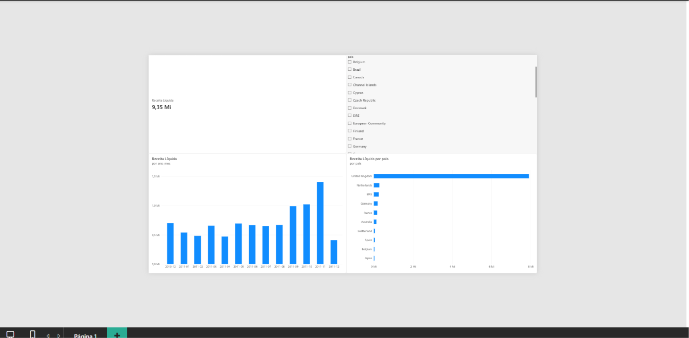

# Projeto Varejo: PostgreSQL + Docker + SQL + Power BI

Análise de vendas de uma loja online de presentes (dez/2010 a dez/2011), do banco de dados ao dashboard.
O foco é responder perguntas de negócio: de onde vem a receita, quem são os clientes que sustentam o
faturamento, onde o cancelamento pesa e como as vendas se comportam ao longo do ano.



## Resultados principais

Todos os valores em libras (£), considerando **receita líquida = vendas + cancelamentos, sem linhas duplicadas**
(£9,35 milhões no total).

**1. A receita é muito concentrada no Reino Unido.**
O Reino Unido responde por **84,6%** da receita líquida (£7,91 mi). Os 10 maiores países somam 97,6%;
os outros 28 dividem 2,4%.

**2. Holanda, Irlanda e Austrália dependem de poucos clientes.**
Os três aparecem entre os maiores mercados, mas têm só 9, 3 e 9 clientes. Um único cliente responde por
**98,3%** da receita da Holanda e **90,3%** da Austrália; na Irlanda, dois clientes somam 98,3%.
São clientes recorrentes (compram quase todos os meses), então o risco está na oscilação do valor mensal,
não na ausência de compras. Alemanha e França, menores, têm cerca de 90 clientes cada com ticket parecido
com o do Reino Unido, e são mercados mais diversificados.

**3. Cancelamento pesa no Reino Unido; a taxa da Espanha engana.**
O Reino Unido cancelou £812 mil (9,3% do vendido), cerca de **91% de todo o valor cancelado**. A Espanha
tem a maior taxa do top 10 (12,2%), mas três faturas somam 94% do valor cancelado no país. Com uma base de
apenas £55 mil vendidos, o indicador é instável e não deve guiar decisões.

**4. As vendas se concentram no fim do ano.**
Setembro a novembro respondem por **36,5%** da receita, e novembro (£1,40 mi) é mais que o dobro de agosto.
Com apenas 12 meses de histórico não dá para separar sazonalidade de crescimento. Dezembro/2011 tem só
9 dias de dados e não deve ser lido como queda.

**5. Segmentação RFM: 22% dos clientes geram 65% da receita.**
941 clientes "Campeões" respondem por 64,6% da receita. Há 282 clientes de alto valor que pararam de
comprar (£481 mil em histórico), o grupo onde uma ação de reativação tem melhor retorno. Os 1.081 clientes
"perdidos" pesam só 5,9%.

**6. Retenção por coorte: cerca de 1 em cada 5 clientes novos volta no mês seguinte.**
Nas coortes de jan a out/2011, a retenção no mês 1 fica entre 15% e 23%, e a curva oscila em vez de cair de
forma contínua: parte dos clientes reaparece meses depois, o que sugere compras irregulares de revendedores
(hipótese, não confirmada pelos dados).

## Stack

- **PostgreSQL 16** em container **Docker**
- **SQL** (CTEs, window functions, `FILTER`, `NTILE`, `LAG`) para modelagem e análise
- **Power BI** conectado ao banco, com medidas em DAX
- **Python** (pandas, SQLAlchemy, matplotlib) para consultas e gráficos
- **Git/GitHub**

## Estrutura do repositório

```
docker-compose.yml      PostgreSQL 16 em container
data/                   coloque aqui o CSV (vendas.csv); não é versionado
sql/01_schema.sql       cria schemas e tabela de staging (automático no 1º start)
sql/02_carga.sql        carrega o CSV na staging
sql/03_modelo.sql       esquema estrela (dim_* e fato_vendas) e a view dw.vw_vendas
sql/04_analises.sql     6 análises: país/mês, top produtos, cancelamento, MoM, RFM, coorte
python/                 exemplo de leitura do banco com pandas + gráfico
docs/                   captura do dashboard
```

## Modelo de dados

Esquema estrela no schema `dw`:

- `fato_vendas`: uma linha por item de fatura (541.909 linhas)
- `dim_pais` (38), `dim_cliente` (4.372), `dim_produto` (3.958), `dim_data` (374 dias)
- `vw_vendas`: view pronta para análise e para o Power BI, que já aplica as regras de negócio abaixo

## Regras de negócio

- Receita líquida = `Venda` + `Cancelamento`, sem linhas marcadas como duplicadas.
- Ajustes de estoque, taxas/serviços e ajustes contábeis ficam fora da view.
- Cerca de 25% das linhas não têm `CustomerID`: entram nas análises de receita, mas ficam fora de RFM e coorte.
- O cancelamento aparece no mês em que ocorre, e não no mês da venda original; por isso a taxa é uma aproximação.

## Como rodar

Pré-requisito: Docker Desktop aberto. Os comandos abaixo rodam dentro da pasta do projeto.

1. **Coloque o CSV** em `data/vendas.csv` (separador `;`, UTF-8, com as colunas `InvoiceNo`, `StockCode`,
   `Description`, `Quantity`, `InvoiceDate`, `UnitPrice`, `CustomerID`, `Country`, `Revenue`, `Tipo`,
   `AnoMes`, `Duplicada`).
2. **Suba o banco:**
   ```
   docker compose up -d
   ```
3. **Carregue os dados** (deve mostrar `541909`):
   ```
   docker compose exec -T db psql -U analista -d varejo -f /sql/02_carga.sql
   ```
4. **Monte o modelo:**
   ```
   docker compose exec -T db psql -U analista -d varejo -f /sql/03_modelo.sql
   ```
   A conferência final deve mostrar `linhas_fato = 541909` e `receita_liquida = 9353925.40`.
5. **Analise:** rode as consultas de `sql/04_analises.sql` em um cliente SQL (DBeaver, pgAdmin ou `psql`).

Conexão: servidor `localhost`, porta `5432`, banco `varejo`, usuário `analista`, senha `analista123`
(credenciais de desenvolvimento local).

Para o Python:
```
pip install -r python/requirements.txt
python python/01_receita_mensal.py
```

## Dashboard (Power BI)

Conectado à view `dw.vw_vendas` (modo Importar). Medidas principais:

```
Receita Líquida = SUM(vendas[receita])
Receita Vendida = CALCULATE(SUM(vendas[receita]); vendas[tipo] = "Venda")
Valor Cancelado = -CALCULATE(SUM(vendas[receita]); vendas[tipo] = "Cancelamento")
% Cancelamento  = DIVIDE([Valor Cancelado]; [Receita Vendida])
Faturas         = CALCULATE(DISTINCTCOUNT(vendas[fatura]); vendas[tipo] = "Venda")
Clientes        = DISTINCTCOUNTNOBLANK(vendas[cliente_id])
```

O total do cartão (£9,35 mi) e o valor do Reino Unido (£7.912.637,69) batem com o resultado do SQL.

## Limitações

- Apenas 12 meses de dados: não é possível separar sazonalidade de crescimento.
- Dez/2011 é um mês parcial (dados até 09/12/2011).
- Os segmentos de RFM usam cortes por quintis definidos por mim; outros cortes mudariam os grupos.
- As hipóteses sobre revendedores/atacadistas não foram confirmadas com dados de perfil de cliente.

## Próximos passos

- Segunda página do dashboard (cancelamentos e segmentos RFM).
- Notebook em Python com análise exploratória e mapa de calor da retenção por coorte.
- Automação do relatório semanal com n8n.

## Autor

Bruno Nascimento Bat. [GitHub](https://github.com/batistabuka-hue)

Base: Online Retail (UCI Machine Learning Repository), com limpeza prévia (colunas `Revenue`, `Tipo`, `AnoMes` e `Duplicada`).
